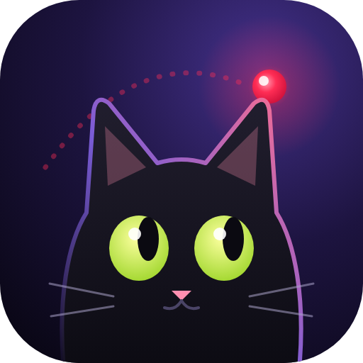
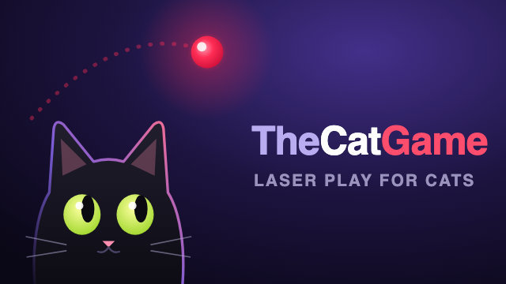

#  TheCatGame



A laser, fish & bird cat toy for Android TV / projectors controlled live from your phone or computer browser over a Cloudflare Pages + Durable Objects relay (or directly over local Wi-Fi).

## How it works

- **`app/`** — Lightweight native Android TV app (`com.cashewpeanut.cattoy`) that draws a smooth full-screen laser dot, 🐟 fish, or 🐦 bird on your projector/TV and connects to the live controller.
- **`cloudflare/relay/`** — Cloudflare Worker + Durable Object WebSocket room relay (`thecatgame-relay`).
- **`cloudflare/site/`** — Installable mobile/desktop PWA controller (`thecatgame.pages.dev`) with drag/hover tracking, shape toggles, and hide-on-release mode.

## Build & Deploy

### Android TV APK (no Gradle required)
```bash
./build.sh            # builds build/CatToy.apk using Android SDK build-tools
DEVICE=<ip>:5555 ./build.sh install
```

### Cloudflare Relay & Controller Site
```bash
./cloudflare/deploy.sh
```
